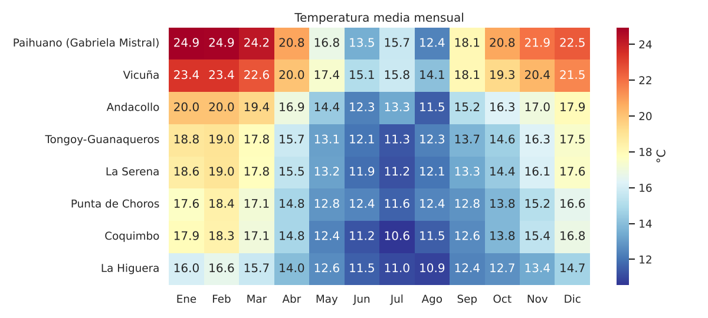
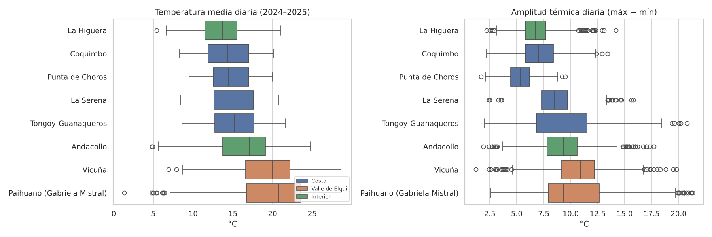
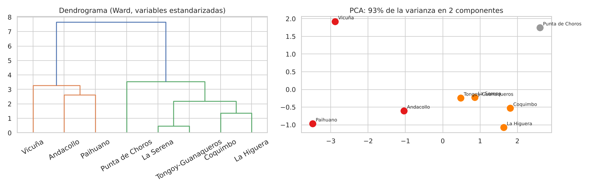

# Microclimas de la Región de Coquimbo: costa vs. valle (2024–2025)

Análisis exploratorio del clima diario en 8 localidades de la Región de Coquimbo durante dos años completos: temperatura, amplitud térmica, lluvia, radiación y humedad, más un agrupamiento de localidades por clima.



## Hallazgos

| Grupo | Localidades | T° media | Amplitud diaria | Humedad |
|---|---|---|---|---|
| Interior cálido y seco | Vicuña, Paihuano, Andacollo | 16–20 °C | 9–11 °C | 40–58 % |
| Costa templada | Coquimbo, La Serena, Tongoy, La Higuera | 13–15 °C | 7–9 °C | > 74 % |
| Costa muy estable | Punta de Choros | 14,6 °C | **5,3 °C** | 82 % |

- La amplitud térmica crece con la elevación y la distancia al mar: la camanchaca modera la costa; en el valle de Elqui el día es cálido y la noche fría.
- La lluvia se concentra en 12–18 días al año y en pocos frentes de invierno que llegan a toda la región el mismo día (13–14 jun y 2 ago 2024; 1 ago 2025).
- Punta de Choros aparece como un clima aparte, igual que en el laboratorio original.

| | |
|---|---|
|  |  |

El dashboard interactivo (Plotly) está en `figures/dashboard_temperaturas.html`: descárgalo y ábrelo en el navegador.

## Datos
- **Open-Meteo Historical Weather API** (reanálisis, gratuita y sin API key). El CSV ya viene en `data/`; si lo borras, el notebook lo vuelve a descargar.
- Variables diarias: T° máxima, mínima y media, precipitación, viento máximo, radiación solar y humedad relativa.

## Contenido

```
├── data/clima_coquimbo_2024_2025.csv            # 8 localidades × 731 días
├── data/resumen_localidades.csv
├── notebooks/microclima_coquimbo.ipynb           # Análisis completo (Colab / Jupyter)
├── originales/Lab01_OpenWeather_CEAZA_original.ipynb   # Laboratorio original: scraping de CEAZA + API OpenWeather
└── figures/
```

El laboratorio original (con Vicente Riveros) obtenía las localidades haciendo *web scraping* de CEAZA y los datos horarios desde la API de OpenWeather (ene–ago 2025). Para usarlo hay que poner una API key propia en la variable de entorno `OPENWEATHER_API_KEY`.

## Cómo ejecutarlo

```bash
pip install -r requirements.txt
jupyter notebook notebooks/microclima_coquimbo.ipynb
```

## Limitaciones
Open-Meteo entrega reanálisis en una grilla de ~10 km, así que los puntos costeros mezclan parte del océano. Por eso el orden de las localidades más cálidas difiere del laboratorio original. Para un estudio fino conviene contrastar con las estaciones de CEAZA.

## Origen
Versión ampliada del Laboratorio 1 de Machine Learning (API key y web scraping), Ingeniería Civil Industrial, UCN (2025-2).

**Autor:** Mario Coroseo Ramos
